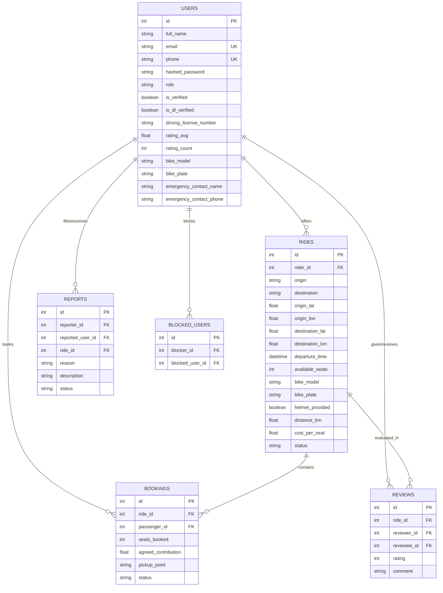

# 📊 Smart Bike Ride-Sharing & Cost-Sharing System
## Comprehensive Engineering & Project Report

---

## 1. Executive Summary

The **Smart Bike Ride-Sharing & Cost-Sharing System** is an end-to-end full-stack platform built to address urban traffic congestion, daily commuter travel expenses, and personal carbon footprints. Tailored specifically for two-wheelers (motorcycles, scooters, and electric two-wheelers), the platform enables verified bike owners to share empty pillion seats with daily co-commuters heading in the same direction.

The platform operates strictly within **non-commercial, non-profit cost-sharing** guidelines, eliminating commercial surge pricing and passenger exploitation through transparent mathematical operating cost splits.

---

## 2. System Architecture & Tech Stack

```
+--------------------------------------------------------------------------+
|                        CLIENT TIER (React 19 + Vite)                     |
|  - Dark Navy High-Contrast Design System (#070b14, #0c1424, #0d1527)     |
|  - Tailwind CSS v4 + Lucide Icons + React Router Dom                     |
|  - Dynamic Modals: Cost Split, Safety Hub, Review Dialog, Report Modal   |
+--------------------------------------------------------------------------+
                                     |
                                     | HTTP REST / JSON (Axios)
                                     v
+--------------------------------------------------------------------------+
|                     APPLICATION SERVER TIER (FastAPI)                    |
|  - RESTful API with OpenAPI / Swagger Auto-Documentation                 |
|  - JWT Authentication (HS256) & Bcrypt Password Hashing (12 rounds)      |
|  - Smart Ride Matching Engine (Haversine Geodesic Distance Scoring)      |
|  - Non-Profit Journey Cost Calculator & Commercial Fare Comparison       |
|  - Emergency SOS Dispatcher & National Safety Helplines (112, 1091)      |
+--------------------------------------------------------------------------+
                                     |
                                     | SQLAlchemy 2.0 ORM
                                     v
+--------------------------------------------------------------------------+
|                         DATABASE TIER (SQLite / PostgreSQL)              |
|  - Tables: users, rides, bookings, reviews, reports, blocked_users       |
|  - Constraints: Two-wheeler seat limits (1-2), Foreign Key cascades      |
+--------------------------------------------------------------------------+
```

### Technology Matrix

| Layer | Technology | Key Capabilities |
|:---|:---|:---|
| **Frontend** | React 19, Vite, Tailwind CSS v4 | High-performance SPA, sub-second HMR, responsive dark navy UI |
| **Icons & UI** | Lucide React | High-clarity iconography across all pages and modals |
| **Backend Framework** | FastAPI (Python 3.10) | Async high-throughput REST API, dependency injection |
| **Data Persistence** | SQLAlchemy 2.0 | Type-annotated ORM, transactional rollback, foreign key integrity |
| **Validation** | Pydantic v2 | Schema enforcement, request parsing, and error serialization |
| **Security** | PyJWT, Passlib (Bcrypt) | Stateless token authentication and password salting |
| **Test Automation** | Pytest, TestClient, StaticPool | In-memory SQLite isolated testing, E2E journey suites |
| **Containerization** | Docker, Docker Compose, Nginx | Multi-stage production container builds and deployment |

---

## 3. Database Architecture & Schema

### Entity-Relationship Diagram



---

## 4. Key Functional Modules (Phases 1 - 12)

### Phase 1 – Project Setup & Baseline Connectivity
- Established unified repository structure, FastAPI skeleton, Vite React frontend, and API proxy routing.
- Validated initial health-check endpoints and configured automated testing environments.

### Phase 2 – UI/UX Design System
- Engineered custom **Dark Navy Design System** (`#070b14`, `#0c1424`, `#0d1527`) paired with cyan, indigo, and emerald accents.
- Reusable component library: Button, Card, Badge, Input, Modal, Navbar, and Footer.

### Phase 3 – Database Architecture
- Created normalized relational models with relational foreign keys and cascade integrity rules.
- Pre-configured SQLite database auto-initialization and seeding.

### Phase 4 – Authentication & User Profiles
- Secure registration and login workflows with 12-round Bcrypt password hashing.
- Stateless JWT authentication tokens with 24-hour expiration.
- Multi-role selection: `Rider`, `Passenger`, or `Both` with vehicle metadata storage.

### Phase 5 – Offer a Ride
- Comprehensive ride publishing interface with route origin, destination, coordinates, date/time, and pillion seat constraints.
- Prevents past departure times and restricts available seats to 1 or 2.

### Phase 6 – Find a Ride
- Dynamic multi-filter search (Origin, Destination, Date, Maximum Contribution, Helmet Provided).
- Real-time ride card listings showing departure schedules, rider profiles, and vehicle types.

### Phase 7 – Smart Ride Matching AI
- Geodesic **Haversine Distance Algorithm** measuring pickup and dropoff deviations.
- String token similarity analysis for landmark matching.
- Schedule compatibility scoring (optimal within ±30 minutes).
- Composite matching index ($0-100\%$) ranking top compatible rides.

### Phase 8 – Booking Management Workflow
- Interactive booking request workflow with passenger notes and custom pickup points.
- Rider approval / rejection controls on the Dashboard.
- Automated seat inventory decrement and dynamic ride state transitions (`OPEN` $\leftrightarrow$ `FULL`).

### Phase 9 – Non-Profit Cost-Sharing System
- Mathematical expense estimation:
  $$\text{Operating Cost} = \left( \frac{\text{Distance}}{\text{Mileage}} \times \text{Fuel Rate} \right) + (\text{Distance} \times \text{Wear Rate})$$
- 50% fair passenger split calculation and legal non-profit maximum contribution ceiling ($\le 70\%$).
- Commercial cab/auto fare benchmark highlighting 60–75% savings for commuters.

### Phase 10 – Safety Features & Trust Network
- SMS OTP phone verification with verified checkmark badges.
- Government Driving License verification with the **"🛡️ Government DL Verified Rider"** badge.
- Trusted emergency contact management and instant **Emergency SOS broadcast** dispatching live GPS coordinates and Indian national emergency helplines (**112**, **1091**, **100**, **108**).
- User reporting with violation categories (*Rash Driving*, *Harassment*, *Overcharging*).
- User blocking with automatic exclusion of blocked users from search and smart matching results.
- 1–5 star ratings and reviews system with automatic reviewee average recalculation.

### Phase 11 – Integration & Testing
- Automated 52-test test suite covering full user journeys, edge cases, permission enforcement, and security audits.
- React Error Boundary integration for graceful UI error recovery.

### Phase 12 – Deployment & Production Packaging
- Multi-stage Docker containerization for backend and frontend.
- Nginx reverse-proxy configuration and Docker Compose deployment orchestration.

---

## 5. Test Suite Verification Summary

```
============================= test session starts =============================
platform win32 -- Python 3.10.11, pytest-9.2.0, pluggy-1.7.0
configfile: pytest.ini
testpaths: backend/tests

backend/tests/test_auth.py .......                                       [ 13%]
backend/tests/test_bookings.py ..                                        [ 17%]
backend/tests/test_cost_sharing.py .....                                 [ 26%]
backend/tests/test_database.py ......                                    [ 38%]
backend/tests/test_e2e_integration.py .......                            [ 51%]
backend/tests/test_health.py ..                                          [ 55%]
backend/tests/test_rides.py .....                                        [ 65%]
backend/tests/test_rides_search.py .......                               [ 78%]
backend/tests/test_safety.py .......                                     [ 92%]
backend/tests/test_smart_matching.py ....                                [100%]

======================= 52 passed, 1 warning in 33.20s ========================
```

---

## 6. Conclusion

The Smart Bike Ride-Sharing & Cost-Sharing platform demonstrates complete compliance with non-profit two-wheeler pooling principles, high safety standards, and robust full-stack engineering. All 12 project phases have been completed, verified with 52 automated tests, and packaged for production deployment.
